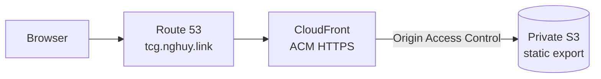
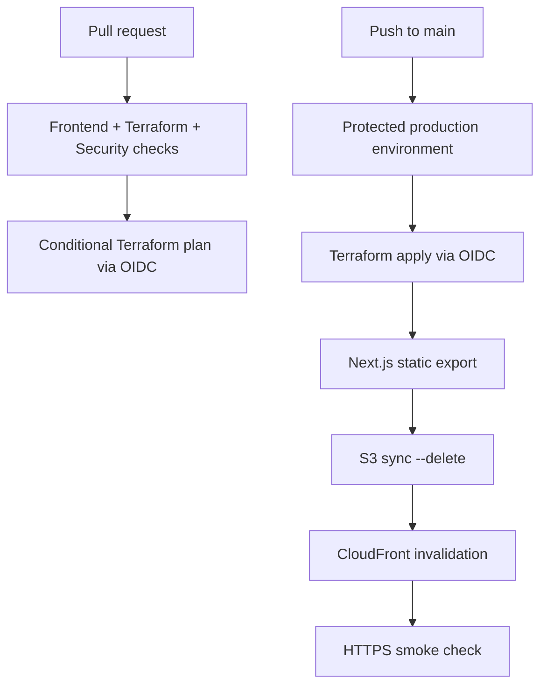

# DevOps TCG Architecture

DevOps TCG is a static, read-only study deck. It has no server runtime or
application data plane beyond CloudFront reading committed static files from a
private S3 origin.

## Runtime Request Flow



Route 53 A and AAAA aliases target CloudFront. CloudFront redirects HTTP to
HTTPS, negotiates TLS with an ACM certificate created in `us-east-1`, applies
browser security headers, and signs origin requests with OAC. The S3 bucket
rejects public access and permits object reads only from the distribution ARN.

## Delivery Flow



The deployment workflow builds and tests the frontend before Terraform apply,
then creates a fresh deployable export after validating Terraform outputs. The
diagram groups pre-apply quality work into the protected Deploy stage and shows
the final publish sequence after infrastructure is available.

## Resource Ownership

| Directory | Responsibility |
| --- | --- |
| `frontend/` | Typed card content, accessible interaction, static export, unit and browser tests |
| `infra/bootstrap/` | One-time private/versioned S3 state bucket and DynamoDB lock table |
| `infra/modules/domain/` | Existing public-zone lookup, exact-domain ACM certificate, and DNS validation records |
| `infra/modules/frontend/` | Private/versioned site bucket, OAC, bucket policy, CloudFront caching, HTTPS, headers, and 404 behavior |
| `infra/envs/prod/` | Regional providers, module composition, `tcg.nghuy.link` A/AAAA aliases, and deploy outputs |
| `.github/workflows/quality.yml` | Frontend gates, offline infrastructure checks, and conditional OIDC plan |
| `.github/workflows/deploy.yml` | Staged pipeline: configuration preflight, pnpm gate, protected OIDC apply with static publish, invalidation and HTTPS smoke check, then the run report and Slack notification |

The `nghuy.link.` hosted zone is external shared infrastructure. Terraform reads
its ID and manages only records required by `tcg.nghuy.link`.

## Static Build Data

```text
ConceptCardData + local WebP
  -> Next.js static export
  -> frontend/out
  -> aws s3 sync --delete
  -> sw.js + manifest.webmanifest re-uploaded with Cache-Control: no-cache
  -> CloudFront invalidation
```

## Installable App (PWA)

The site is an installable Progressive Web App. `src/app/manifest.ts` emits
`/manifest.webmanifest` (standalone display, icons under `public/icons/`), the
layout sets `viewport-fit=cover` and Apple's web-app tags, and `globals.css`
pads the shell and the modal layer by the safe-area insets so nothing sits
under the notch or the home indicator.

`scripts/build-sw.mjs` runs after `next build` and writes `out/sw.js` from
`scripts/sw-template.js`, inlining every file in the export and a sha256 of
their contents. The worker precaches the whole export on install, so the deck
works offline after one visit; serves navigations network-first and
everything else cache-first; and deletes every older `devops-tcg-*` cache on
activate. A deploy that changes any file therefore ships a new worker, and an
installed app picks it up on its next launch. The deploy re-uploads `sw.js`
with `Cache-Control: no-cache` so neither CloudFront nor the browser can hold
an old worker. The CSP needs no change: `worker-src` and `manifest-src` fall
back to `default-src 'self'`.

The browser makes no application API calls and receives no application
credentials, cookies, or user-specific content.

## Intentionally Absent

- Cognito or any authentication provider
- API Gateway or Next.js API routes
- Lambda or another server runtime
- Application DynamoDB tables or another database
- CloudFront `/api/*` behavior
- Runtime image or card-content downloads
- Accounts, scores, progress, or any user state beyond the theme and layout
  choices
- Browser persistence other than two `localStorage` keys, both of them
  per-browser conveniences holding no card data, no identity and nothing the
  site reads back on the server. `devops-tcg-theme` holds `neon` or `sketch`,
  and is read by a pre-paint inline script and by the header toggle.
  `devops-tcg-view` holds `grid` or `deck`, and is read by the explorer after
  mount — it needs no pre-paint script because nothing that depends on the
  viewport renders until that measurement lands. Neither is ever sent anywhere,
  and an unreadable or unrecognised value resolves to its own default. The
  service worker's Cache Storage is not an exception: it holds a copy of the
  public static export and nothing else — no user data, nothing written by the
  reader.
